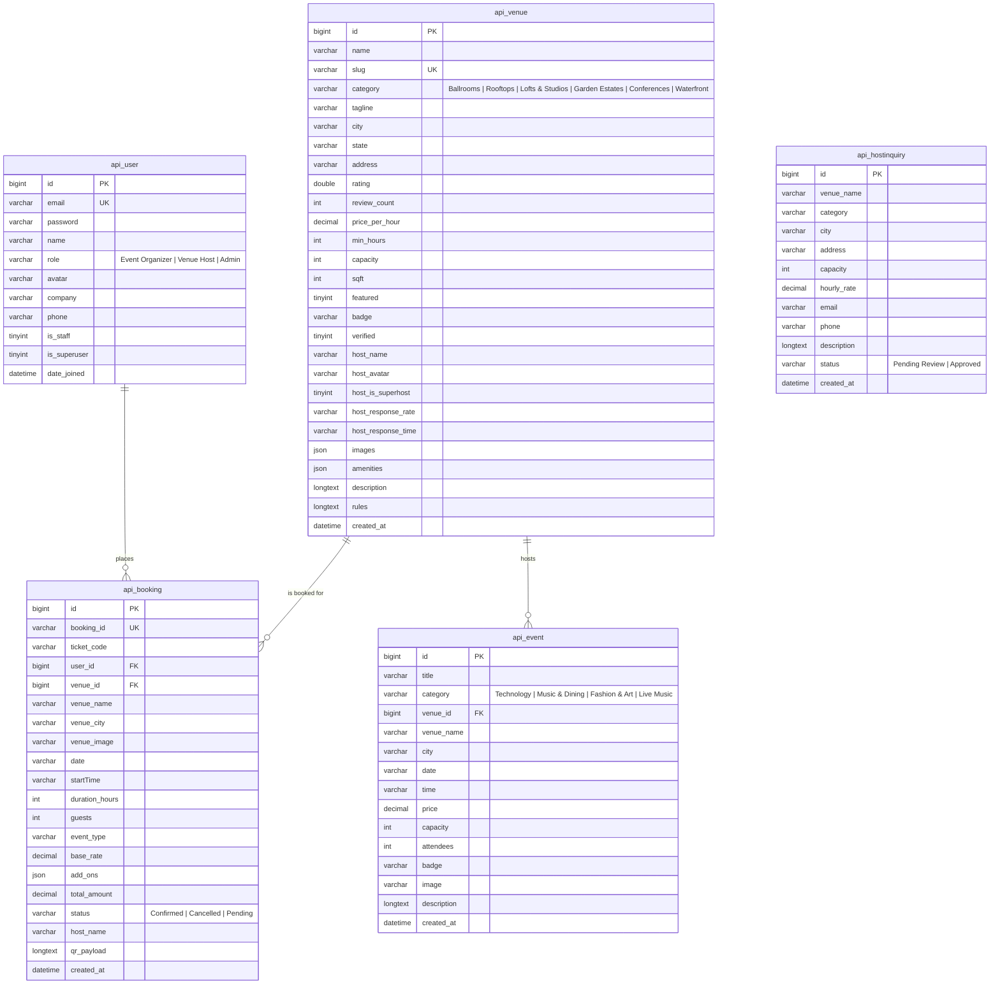

# VenueVista Database Documentation & Architecture

> **⚠️ IMPORTANT (Django ke saath MySQL use karna hai to):** neeche ke `.sql` dumps Django ke `migrate` ke saath mix mat karo (dump me `django_migrations`, `auth_*` aur M2M tables nahi hain, isliye `migrate` par *Table already exists* error aata hai).
> Sahi tareeka: project root se `setup_mysql.bat` chalao, ya `cd backend` -> `python setup_mysql.py`. Ye database banata hai, `migrate` chalata hai aur demo data seed karta hai.
> Ye `.sql` files sirf standalone/phpMyAdmin reference ke liye hain.


This directory contains complete schema definitions, data dumps, fixtures, and export scripts for VenueVista.

---

## 📁 Files Overview

| File | Purpose | Target Database |
| :--- | :--- | :--- |
| **`schema.sql`** | Table creation DDL statements, indexes, and foreign keys | MySQL 5.7+ / 8.0+ / MariaDB |
| **`seed_data.sql`** | Initial seed data inserts (demo credentials, 6 venues, 4 events, reservations) | MySQL / MariaDB |
| **`venuevista_mysql_dump.sql`** | All-in-one complete dump (`CREATE DATABASE`, schema, and seed data) | MySQL / phpMyAdmin / Workbench |
| **`venuevista_sqlite.sql`** | Complete DDL & DML script | SQLite 3 / DB Browser for SQLite |
| **`fixtures.json`** | Standard Django JSON fixtures for `python manage.py loaddata` | Django ORM |
| **`export_db.py`** | Automation script to re-export database state from Django | Python 3 |

---

## 📊 Entity-Relationship (ER) Diagram



---

## 🚀 How to Import

### Option 1: MySQL CLI
```bash
mysql -u root -p < database/venuevista_mysql_dump.sql
```

### Option 2: phpMyAdmin
1. Open phpMyAdmin (`http://localhost/phpmyadmin`).
2. Click **Import** tab.
3. Choose `database/venuevista_mysql_dump.sql`.
4. Click **Go**. The database `venuevista_db` and all tables with records will be created.

### Option 3: SQLite (Command Line or DB Browser)
```bash
sqlite3 backend/db.sqlite3 < database/venuevista_sqlite.sql
```

### Option 4: Django Fixtures
To reload data directly inside the Django backend environment:
```powershell
cd backend
.\venv\Scripts\python.exe manage.py loaddata ..\database\fixtures.json
```

---

## 🔑 Pre-Seeded Accounts in the Database

| Email | Password | Role | Account Details |
| :--- | :--- | :--- | :--- |
| `elena.vance@eventcraft.com` | `Password123!` | Event Planner | Elena Vance (Vance Luxury Events) |
| `marcus@luminarygroup.com` | `Password123!` | Venue Host | Marcus Sterling (Luminary Venues NYC) |
| `admin@venuevista.com` | `Password123!` | Admin | Superuser with full `/admin/` access |

*Note: Passwords in the SQL dumps are stored as secure PBKDF2 SHA-256 hashes compatible with Django's authentication system.*
